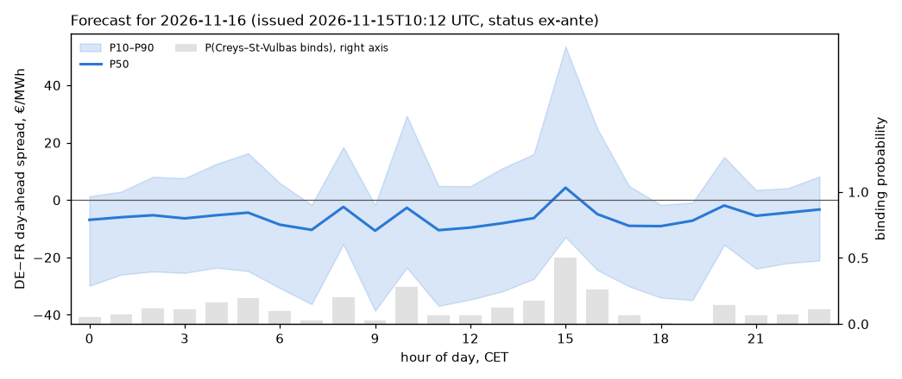
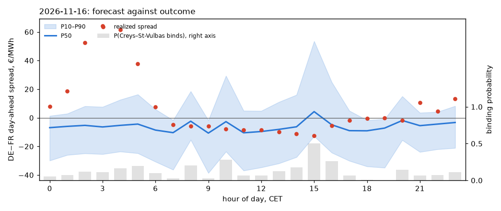

# Scorecard: Core binding-constraint forecast

Last scoring run: 2026-11-15 19:26 UTC. All published days scored.

## Latest forecast: 2026-11-16

| Product | P(spread > 0) | P50 (P10 to P90), €/MWh |
| --- | --- | --- |
| Base (24 h) | 0.34 | -6.0 (-27.0 to +10.3) |
| Peak (08–21) | 0.36 | -6.0 (-27.7 to +13.7) |

| Block | Expected binding hours | P(DE > FR) | Spread P50 (P10 to P90), €/MWh |
| --- | --- | --- | --- |
| night 00–05 | 0.7 | 0.07 | -6 (-26 to +8) |
| morning 06–09 | 0.3 | 0.11 | -8 (-30 to +5) |
| midday 10–14 | 0.7 | 0.10 | -7 (-31 to +13) |
| afternoon 15–17 | 0.8 | 0.23 | -3 (-22 to +28) |
| evening 18–20 | 0.2 | 0.12 | -6 (-28 to +4) |
| late 21–23 | 0.3 | 0.09 | -4 (-22 to +5) |

Hour by hour

| Hour (CET) | P(bind) | P(DE > FR) | P10 | P50 | P90 |
| --- | --- | --- | --- | --- | --- |
| 00 | 0.05 | 0.05 | -30 | -7 | +1 |
| 01 | 0.07 | 0.06 | -26 | -6 | +3 |
| 02 | 0.12 | 0.07 | -25 | -5 | +8 |
| 03 | 0.11 | 0.07 | -25 | -6 | +8 |
| 04 | 0.16 | 0.09 | -24 | -5 | +13 |
| 05 | 0.20 | 0.08 | -25 | -4 | +16 |
| 06 | 0.10 | 0.06 | -31 | -9 | +6 |
| 07 | 0.03 | 0.03 | -36 | -10 | -2 |
| 08 | 0.20 | 0.32 | -15 | -2 | +18 |
| 09 | 0.02 | 0.01 | -39 | -11 | -2 |
| 10 | 0.28 | 0.36 | -24 | -3 | +29 |
| 11 | 0.07 | 0.02 | -37 | -10 | +5 |
| 12 | 0.06 | 0.02 | -35 | -10 | +5 |
| 13 | 0.12 | 0.03 | -32 | -8 | +11 |
| 14 | 0.18 | 0.06 | -28 | -6 | +16 |
| 15 | 0.51 | 0.59 | -13 | +4 | +54 |
| 16 | 0.26 | 0.08 | -24 | -5 | +25 |
| 17 | 0.07 | 0.03 | -30 | -9 | +5 |
| 18 | 0.01 | 0.02 | -34 | -9 | -2 |
| 19 | 0.00 | 0.02 | -35 | -7 | -1 |
| 20 | 0.14 | 0.33 | -16 | -2 | +15 |
| 21 | 0.06 | 0.09 | -24 | -6 | +4 |
| 22 | 0.07 | 0.09 | -22 | -4 | +4 |
| 23 | 0.11 | 0.11 | -21 | -3 | +8 |

## Base and peak spread, day by day

Base is the 24-hour average DE−FR day-ahead spread; peak is the average over delivery 08:00–21:00 CET. The forecast is the average of the hourly P10, P50 and P90; P(> 0) is read off that band with a normal approximation.

| Day | Base P50 (P10 to P90) | Base actual | P(base > 0) | Peak P50 (P10 to P90) | Peak actual | P(peak > 0) |
| --- | --- | --- | --- | --- | --- | --- |
| 2026-11-16 | -6.0 (-27.1 to +10.3) | +8.1 | 0.34 | -6.0 (-27.7 to +13.7) | -6.1 | 0.36 |
| 2026-11-11 | +8.1 (+0.1 to +52.6) | +64.4 | 0.65 | +7.5 (-1.5 to +52.2) | +101.0 | 0.64 |

### Base and peak skill (all counted days)

| Product | Days | P50 error, €/MWh | Climatology level error | Yesterday's value error | 80% band coverage | Sign hit | Sign Brier | Sign Brier, climatology |
| --- | --- | --- | --- | --- | --- | --- | --- | --- |
| Base | 2 | 35.2 | 37.4 | 24.9 | 50% | 50% | 0.279 | 0.274 |
| Peak | 2 | 46.8 | 53.6 | 57.0 | 50% | 100% | 0.130 | 0.250 |

Error columns are mean absolute differences between the forecast level and the outcome (lower is better). The climatology level is the hour-of-day climatology aggregated the same way, and yesterday's value is the previous day's realized product. Few days are counted so far, so read these figures as provisional.
Forecasts are issued each morning for the next CET day from the published JAO domain, before the day-ahead auction closes; only forecasts whose issue time precedes the publication of the results count (status `ex-ante`). Metrics compare each forecast with the hour-of-day climatology of the training window.

| Window | Hours | Days | Bind Brier | Bind Brier, climatology | Bind hit | Bind hit, climatology | Sign Brier | Sign Brier, climatology | Sign hit | Sign hit, climatology |
| --- | --- | --- | --- | --- | --- | --- | --- | --- | --- | --- |
| All ex-ante forecasts | 144 | 6 | 0.163 | 0.214 | 79% | 67% | 0.206 | 0.273 | 69% | 59% |
| Last 14 days | 144 | 6 | 0.163 | 0.214 | 79% | 67% | 0.206 | 0.273 | 69% | 59% |
| Afternoon hours 13–19 CET | 42 | 6 | 0.133 | 0.230 | 79% | 57% | 0.149 | 0.235 | 74% | 64% |

## By day: afternoon block 15–17 CET and binding hours

| Day | P(DE > FR), 15–17 | Spread P50 (P10–P90), 15–17, €/MWh | Actual spread 15–17, €/MWh | Binding hours expected | Binding hours actual | French net position, GW (realized, day mean) |
| --- | --- | --- | --- | --- | --- | --- |
| 2026-11-16 | 0.23 | -3 (-22 to +28) | -6.6 | 3.0 | 11 | +1.4 |
| 2026-11-11 | 0.59 | +7 (-2 to +54) | +104.1 | 11.1 | 15 | +5.8 |
| 2026-11-10 | 0.68 | +6 (-8 to +62) | +85.0 | 4.8 | 5 | +5.6 |
| 2026-11-09 | 0.81 | +10 (-0 to +72) | +76.8 | 9.7 | 0 | +2.9 |
| 2026-11-08 | 0.29 | +5 (-2 to +49) | +3.6 | 2.6 | 2 | +0.8 |
| 2026-11-05 | 0.47 | n/a | -5.3 | 5.5 | 0 | -3.6 |

## Spread quantiles (DE−FR, €/MWh)

| Days | Pinball loss | Pinball, climatology | 80% band coverage | Coverage, climatology | P50 MAE | Climatology median MAE | Zero MAE | Persistence D-1 MAE | Band width |
| --- | --- | --- | --- | --- | --- | --- | --- | --- | --- |
| 5 | 10.47 | 11.54 | 50% | 61% | 28.7 | 29.7 | 29.0 | 31.3 | 39 |

Pinball loss is averaged over the 10th, 50th and 90th percentiles; lower is better. Coverage is the share of hours whose realized spread fell inside the P10–P90 band (target 80%).

A positive French net position means France exported into Core; Creys–St-Vulbas is France's export path and cannot bind on days when France imports.

Afternoon-block sign hit rate: 83% over 6 days; share of days with a positive afternoon spread: 67%.

## Reliability of P(bind)

| Forecast bin | Hours | Mean forecast | Observed frequency |
| --- | --- | --- | --- |
| (0.0, 0.2] | 79 | 0.07 | 0.15 |
| (0.2, 0.4] | 30 | 0.30 | 0.13 |
| (0.4, 0.6] | 15 | 0.49 | 0.40 |
| (0.6, 0.8] | 15 | 0.69 | 0.53 |
| (0.8, 1.0] | 5 | 0.88 | 0.60 |

## Model and backtest

Logistic models on the D-1 published Core domain (Creys–St-Vulbas RAM, loading and minRAM top-up, French max net positions) plus hour-of-day climatology; trained on 2026-09-01 to 2026-11-08 (1655 hour-rows). Held-out backtest 2026-10-22 to 2026-11-08: binding AUC 0.84, Brier 0.139 vs 0.187 climatology; sign AUC 0.87, Brier 0.132 vs 0.202; spread quantiles pinball 5.84 vs 6.44 climatology, P50 MAE 16.4 vs 16.8 for a zero forecast.

## Last scored day: 2026-11-16

## Skill through the day (all counted days)

| Block | Hours | Sign skill | Binding skill | Quantile skill | 80% band coverage | Mean realized spread, €/MWh |
| --- | --- | --- | --- | --- | --- | --- |
| night 00–05 | 36 | building up: 6 of 7 days | | | | +13.6 |
| morning 06–09 | 24 | building up: 6 of 7 days | | | | +32.7 |
| midday 10–14 | 30 | building up: 6 of 7 days | | | | +22.0 |
| afternoon 15–17 | 18 | building up: 6 of 7 days | | | | +42.9 |
| evening 18–20 | 18 | building up: 6 of 7 days | | | | +14.7 |
| late 21–23 | 18 | building up: 6 of 7 days | | | | +4.3 |

Skill is 1 minus the model's squared (or pinball) error divided by that of the hour-of-day climatology: positive means better than climatology, zero equal, negative worse. Coverage should be near 80%. A block shows figures once it has 7 counted days.
